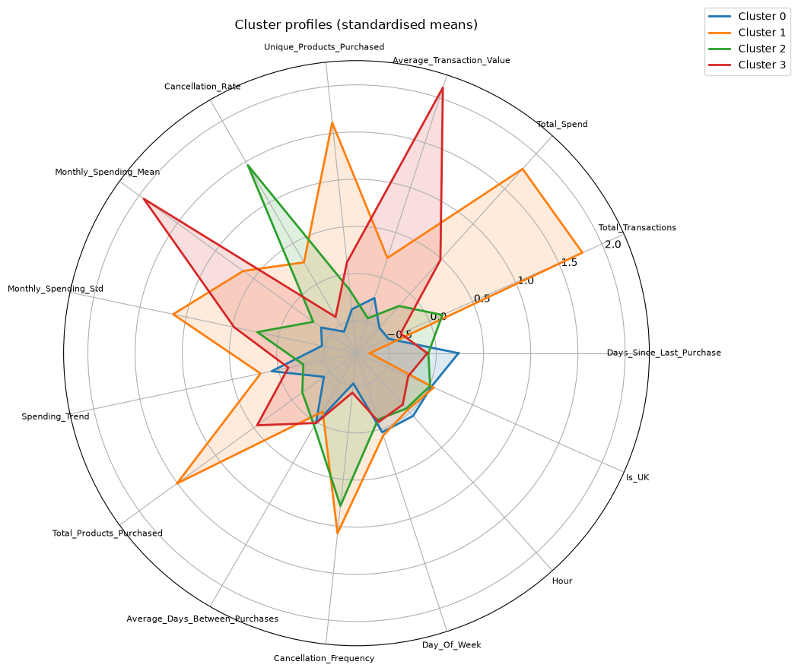

[](https://github.com/roudayn-kouka/Ecommerce-Customer-Segmentation-MLOps/actions/workflows/ci.yml)


# Segmentation client e-commerce — pipeline MLOps

**Autrice : Roudayna Kouka**

Pipeline MLOps de bout en bout qui segmente les clients d'un site e-commerce à partir de leurs
transactions. Elle couvre l'ingestion et le nettoyage des données, le feature engineering,
l'entraînement et la sélection du modèle, une API de prédiction, le suivi de la dérive des
données et l'intégration continue.

```
UCI zip ─► nettoyage (6 étapes) ─► features client (7 étapes) ─► scaling ─► PCA ─► KMeans / GMM
                                                                                     │
          Airflow DAG · DVC · MLflow · GitHub Actions          FastAPI /predict ◄─────┘
```

---

## Résultats

Données : *Online Retail* (UCI), 541 909 transactions d'un e-commerçant britannique
(12/2010 à 12/2011).

| Étape | Lignes / clients |
|---|---|
| Transactions brutes | 541 909 |
| Après suppression des valeurs manquantes | 406 829 |
| Après doublons, codes anormaux, descriptions et prix nuls | 399 567 |
| Clients (features) | 4 362 |
| Clients après suppression des outliers (Isolation Forest, 5 %) | 4 143 |

**Sélection du modèle.** KMeans et le mélange gaussien (GMM) sont comparés pour k = 3 à 8 avec
le score de silhouette. Le meilleur modèle est **KMeans avec k = 4** (silhouette 0,30,
Davies-Bouldin 1,37). Le GMM plafonne à 0,11. La PCA garde 5 composantes, qui expliquent 86 %
de la variance.

| Segment | Clients | Récence (j) | Transactions | Dépense totale (£) | Taux d'annulation | Lecture métier |
|---|---|---|---|---|---|---|
| 0 | 2 266 | 117 | 2,0 | 453 | 0 % | Occasionnels / dormants → campagne de réactivation |
| 1 | 597 | 23 | 11,5 | 3 463 | 15 % | Fidèles à forte valeur → programme VIP |
| 2 | 900 | 85 | 4,7 | 865 | 35 % | Clients à annulations fréquentes → analyser les irritants |
| 3 | 380 | 84 | 2,6 | 1 736 | 3 % | Gros paniers peu fréquents → relances personnalisées |



> Le score de silhouette maximal est obtenu à k = 2 (0,38). Ce découpage est trop grossier pour
> un usage marketing, c'est pourquoi `k_min` est fixé à 3 dans `config/feature_processing.json`.

---

## Architecture MLOps

```mermaid
flowchart LR
    %% ---------- Source ----------
    UCI[("UCI Online Retail<br/>zip / Excel<br/>541 909 transactions")]

    %% ---------- Data pipeline ----------
    subgraph AIRFLOW["Orchestration · Apache Airflow (DAG customer_segmentation, 19 tâches)"]
        direction LR
        subgraph ING["1 · Ingestion"]
            D1[download_data] --> D2[unzip_data] --> D3[load_data]
        end
        subgraph CLEAN["2 · Nettoyage (6 étapes)"]
            C1["valeurs manquantes · doublons<br/>statut transaction · codes anormaux<br/>descriptions · prix nuls"]
        end
        subgraph FEAT["3 · Features client (7 étapes)"]
            F1["RFM · produits uniques · comportement<br/>géographie · annulations · saisonnalité"]
            F2["Isolation Forest<br/>4 143 clients · 15 features"]
            F1 --> F2
        end
        subgraph PRE["4 · Prétraitement"]
            P1[scaler<br/>standard + min-max]
            P2[PCA<br/>5 comp. · 86 %]
            P3[corrélation<br/>heatmap]
            P1 --> P2
            P1 --> P3
        end
        subgraph TRAIN["5 · Modélisation"]
            T1["KMeans vs GMM · k = 3..8<br/>sélection par silhouette"]
            T2["Meilleur : KMeans k = 4<br/>silhouette 0,30"]
            T1 --> T2
        end
        D3 -- "raw_data.pkl" --> C1
        C1 -- "transactions .pkl" --> F1
        F2 -- ".pkl" --> P1
        F2 -- ".pkl" --> T1
    end

    UCI --> D1

    %% ---------- Stockage / tracking ----------
    subgraph STORE["Stockage & suivi"]
        DVC[("DVC + Google Cloud Storage<br/>data/ · models/")]
        MODEL[["segmentation_model.joblib<br/>scaling → PCA → KMeans<br/>+ metrics.json"]]
        MLF[(MLflow<br/>params · métriques · modèle)]
    end
    T2 -- ".joblib" --> MODEL
    T2 -- "métriques" --> MLF
    MODEL --- DVC

    %% ---------- Serving ----------
    subgraph SERVE["Service · Docker (python:3.11-slim)"]
        API["API FastAPI<br/>GET /health · POST /predict"]
    end
    MODEL -- "chargement" --> API
    USER([Application / utilisateur]) -- "JSON features" --> API
    API -- "segment" --> USER

    %% ---------- Monitoring ----------
    subgraph MON["Monitoring"]
        DRIFT["Détection de dérive<br/>PSI + Kolmogorov-Smirnov"]
    end
    API -. "nouveaux lots" .-> DRIFT
    DRIFT -. "dérive ≥ 50 % → réentraînement" .-> AIRFLOW

    %% ---------- CI/CD ----------
    subgraph CICD["CI/CD · GitHub Actions"]
        GH[GitHub] --> LINT[ruff lint]
        GH --> TEST["pytest · Python 3.10–3.12<br/>49 tests · couverture ≥ 80 %"]
        TEST --> IMG[build image Docker API]
    end
    IMG -.-> SERVE

    classDef src fill:#fde68a,stroke:#b45309,color:#000
    classDef store fill:#dbeafe,stroke:#1d4ed8,color:#000
    classDef serve fill:#dcfce7,stroke:#15803d,color:#000
    classDef mon fill:#fee2e2,stroke:#b91c1c,color:#000
    class UCI src
    class DVC,MODEL,MLF store
    class API,USER serve
    class DRIFT mon
```



| Couche | Technologies |
|---|---|
| Données & versionnage | UCI Online Retail, pandas, DVC, Google Cloud Storage |
| Orchestration | Apache Airflow (Docker Compose, CeleryExecutor, PostgreSQL, Redis) |
| Modélisation | scikit-learn (Isolation Forest, PCA, KMeans, GMM), MLflow |
| Service | FastAPI, Uvicorn, Docker |
| Monitoring | PSI, test de Kolmogorov-Smirnov (SciPy) |
| CI/CD & qualité | GitHub Actions, pytest, ruff, pre-commit |

## Structure du code

```
├── src/
│   ├── utils.py            # chemins, logging, lecture/écriture (pickle, parquet), config
│   ├── download_data.py    # téléchargement du zip UCI
│   ├── unzip_data.py       # extraction
│   ├── data_loader.py      # Excel -> cache pickle
│   ├── cleaning.py         # toutes les règles métier (fonctions pures, testables)
│   ├── pipeline.py         # étapes fichier -> fichier + exécution CLI complète
│   ├── scaler.py           # standardisation / normalisation min-max
│   ├── correlation.py      # heatmap + paires fortement corrélées
│   ├── pca.py              # choix automatique du nombre de composantes
│   ├── clustering.py       # sélection KMeans/GMM, entraînement, MLflow, profils
│   ├── drift.py            # détection de dérive (PSI + test de Kolmogorov-Smirnov)
│   └── plots.py            # radar + histogrammes par segment
├── api/                    # API FastAPI + Dockerfile
├── dags/segmentation_dag.py# DAG Airflow (réutilise src/, aucune duplication)
├── config/feature_processing.json
├── test/                   # 49 tests, données synthétiques, hors ligne
├── .github/workflows/ci.yml# lint + tests (3.10-3.12) + build Docker
├── Makefile · pyproject.toml · .pre-commit-config.yaml
└── gcpdeploy/              # ancienne version du déploiement Vertex AI (non maintenue)
```

### Features construites par client

| Famille | Features |
|---|---|
| RFM | `Days_Since_Last_Purchase`, `Total_Transactions`, `Total_Products_Purchased`, `Total_Spend`, `Average_Transaction_Value` |
| Diversité | `Unique_Products_Purchased` |
| Comportement | `Average_Days_Between_Purchases`, `Day_Of_Week`, `Hour` |
| Géographie | `Is_UK` |
| Annulations | `Cancellation_Frequency`, `Cancellation_Rate` |
| Saisonnalité | `Monthly_Spending_Mean`, `Monthly_Spending_Std`, `Spending_Trend` |

---

## Démarrage rapide

```bash
git clone https://github.com/roudayn-kouka/Ecommerce-Customer-Segmentation-MLOps.git
cd Ecommerce-Customer-Segmentation-MLOps
python -m venv .venv && source .venv/bin/activate   # Windows : .venv\Scripts\activate
pip install -r requirements-dev.txt
```

| Commande | Effet |
|---|---|
| `make test` | tests unitaires avec couverture (environ 1 min, sans Internet) |
| `make pipeline` | téléchargement, nettoyage, features, PCA, entraînement (environ 30 s) |
| `make train` | idem, en réutilisant les données locales |
| `make plots` | graphiques des segments dans `data/plots/` |
| `make api` | API sur http://localhost:8000/docs |
| `make lint` / `make format` | ruff |

Sans `make` : `python -m src.pipeline`, `python -m pytest`, `uvicorn api.main:app`.

### API de prédiction

```bash
curl -X POST http://localhost:8000/predict -H "Content-Type: application/json" -d '[{
  "Days_Since_Last_Purchase": 12, "Total_Transactions": 8, "Total_Products_Purchased": 640,
  "Total_Spend": 1450.5, "Average_Transaction_Value": 181.3, "Unique_Products_Purchased": 57,
  "Average_Days_Between_Purchases": 3.4, "Day_Of_Week": 2, "Hour": 12, "Is_UK": 1,
  "Cancellation_Frequency": 1, "Cancellation_Rate": 0.125, "Monthly_Spending_Mean": 181.3,
  "Monthly_Spending_Std": 60.2, "Spending_Trend": 4.1}]'
# -> [{"cluster": 2, "segment": "Segment 2"}]
```

Le modèle sauvegardé contient tout le prétraitement (scaling, puis PCA, puis clustering) : l'API
reçoit les features brutes. On peut nommer les segments avec
`SEGMENT_NAMES="0:Dormants,1:VIP,2:Annulations,3:Gros paniers"`.

Avec Docker : `make docker`, puis
`docker run -p 8000:8000 -v "$(pwd)/models:/app/models" customer-segmentation-api`.

### Suivi de la dérive des données

```bash
python -m src.drift data/reference.parquet data/nouveau_lot.parquet --report drift.json
```

Pour chaque feature, le script calcule le PSI (seuil 0,25) et le test de Kolmogorov-Smirnov
(p < 0,05). Le jeu de données est déclaré en dérive si au moins 50 % des features dérivent. C'est
le signal pour relancer le DAG de réentraînement.

### Airflow

```bash
echo "AIRFLOW_UID=50000" > .env      # nécessaire sous Windows
make airflow-init && make airflow-up # http://localhost:8080
```

Le DAG `customer_segmentation` enchaîne 19 tâches. `src/` est monté dans les conteneurs : le DAG
exécute exactement le même code que la CLI.

### MLflow

`pip install mlflow`. Chaque entraînement est ensuite enregistré : paramètres, métriques
(silhouette, Davies-Bouldin, Calinski-Harabasz) et modèle. Interface : `mlflow ui`.

### DVC

Les données (`data/`) et les modèles sont versionnés avec DVC (`dvc pull` / `dvc push`), pas avec
Git.

---

## Choix techniques et corrections apportées

- **Logique métier séparée des entrées/sorties** : toutes les règles sont dans `cleaning.py`
  sous forme de fonctions pures. `pipeline.py` se limite à lire et écrire les fichiers.
- **Taux d'annulation corrigé** : il est maintenant calculé par jointure sur `CustomerID`. Le
  calcul précédent divisait deux séries alignées sur la position des lignes, ce qui mélangeait
  les clients. Un test de non-régression couvre ce cas.
- **Délai moyen entre achats** : calculé sur les jours d'achat distincts. Avant, les lignes d'une
  même facture comptaient comme des écarts de 0 jour.
- **Normalisation** : `MinMaxScaler`, qui travaille par colonne, remplace `Normalizer`, qui
  normalisait chaque ligne.
- **Plus de blocage interactif** : les boîtes de dialogue `prompt_toolkit` sont supprimées et
  matplotlib utilise le backend `Agg`, ce qui permet au pipeline de tourner dans Airflow et en CI.
- **Erreurs explicites** : une entrée manquante lève `FileNotFoundError`, une erreur HTTP lève
  `HTTPError` et une archive corrompue lève `BadZipFile`.
- **Tests reproductibles** : les données sont synthétiques, il n'y a aucun appel réseau, et la CI
  exige au moins 80 % de couverture.
